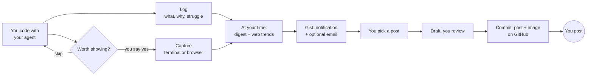
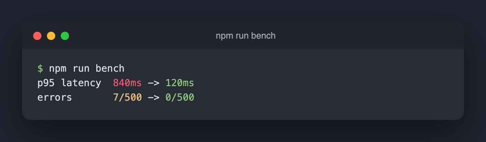

<div align="center">

# 🛠️ Build Your Product in Public

### Your personal build-in-public content strategist, living in your repo.

It logs what you build with your coding agents, captures the moments you approve,<br>
finds the trends nearest to your project and today's work,<br>
and sends you a daily gist with posts to choose from.<br>
Across all your projects, on macOS, Windows and Linux.

[](https://github.com/chetanya1998/build-in-public/actions/workflows/test.yml)
[](LICENSE)


**[🌐 Website](https://chetanya1998.github.io/build-in-public/)** · [Get started](#-getting-started) · [How your day works](#-how-your-day-works) · [Captures](#-captures-only-with-your-ok) · [Daily gist](#-the-daily-gist) · [Posts on GitHub](#-your-posts-on-github) · [All your projects](#-across-all-your-projects-optional) · [Reminders](#-reminders-when-you-go-quiet) · [Privacy](#-privacy)

</div>

---

> **You ship something real almost every day, then post nothing.**
> You forget what you did, or you can't see why anyone would care.

Build Your Product in Public lives in your project. While you code with **Claude Code, Codex or Antigravity**, it keeps a log of what you built and why. When something is worth showing, it asks before capturing your terminal or browser. At the time you choose, it searches the internet for the conversations closest to your project and that day's work, and sends you a gist with a list of suggested posts. You pick one, it writes the post with a real anecdote from your day, and you review it and post it yourself.

**It never posts for you.**

Working on many projects? The optional [`buildinpublic` CLI](#-across-all-your-projects-optional) also keeps a private journal of **every** AI coding session in **every** project, on macOS, Windows and Linux, and [nudges you](#-reminders-when-you-go-quiet) when a couple of days pass without a post.

## 🌅 How your day works



| When | What happens |
|---|---|
| **While you code** | After each meaningful task, your agent adds a short entry to today's log: what, why, how, the struggle and the result, with the exact anecdote (the error, the wrong guess, the fix). |
| **When something's worth showing** | Tests going green after a fight, a benchmark, a new screen in a Playwright test: your agent asks *"Capture this for today's story? 1) terminal output 2) browser screenshot 3) skip"*. Nothing is captured without a yes. |
| **At the time you chose** | It reads the day's agent sessions, git history, log and approved captures, searches the web for the trends nearest to your project and today's work, and writes the brief. |
| **Then** | You get a desktop notification with the gist, and an email too if you gave an address: the day in one line, what you shipped, and **5 to 7 suggested posts**. |
| **When you're ready** | Say *"review my posts"* or *"write post 2"*. Your agent drafts it for your platform, and you revise and approve it. |
| **When you commit** | If sharing is on, your approved posts and their images go into the commit. Push, then open them on GitHub from any device, copy, and post. |

## 📸 Captures, only with your OK

<div align="center">

</div>

| Capture | What's saved |
|---|---|
| **Terminal** | The command's output, redacted, as text for the story and as a terminal-window image like the one above for the post. It can run the command or use output you already have. |
| **Browser** | A screenshot of a page in your running app, on desktop and optionally mobile, with your local Playwright. |
| **Agent screenshots** | Screenshots your agents took during browser tests (Playwright MCP, test reports, Antigravity) are only *candidates*. You approve or reject each one. |

Posts only ever use approved captures. Turn capturing off with `"capture": "off"` in `.buildinpublic/config.json`.

## 📬 The daily gist

At the time you set (`brief_time`, for example 19:00), you get:

- **A desktop notification** with the day's headline.
- **An email (optional)** with the day in one line, what you shipped and the numbered list of suggested posts, with the full brief attached. **All it needs is your address:** no password, no mail server. On macOS it's sent through Apple Mail from the account you already use there. On Linux it goes through your system's `sendmail`.

Each suggested post has a title, platform, angle and hook line, the anecdote it uses, the trend it rides (with a link, or "no trend" when nothing truly fits), the capture to attach, and why it should work.

**The trends come from your project and your day.** Searches are built from three places: today's log entries and commits, the topics you gave during setup, and your stack (read from `package.json`, `requirements.txt`, `pyproject.toml`, `go.mod`, `Cargo.toml` or `Gemfile`). The script checks Hacker News, Reddit, GitHub and dev.to. Then your agent searches the web for what people are discussing on X, LinkedIn and in the news this week. A strong story with no trend beats a forced tie-in.

## 🐙 Your posts on GitHub

Turn on sharing during setup (or run `init.sh --share`), and every commit you make also carries the posts you **approved**, with the images they attach:

```
.buildinpublic/posts/
├── README.md                          ← one page: each post's text and image, newest first
├── 2026-10-22-x-ci-lives-in-utc.md
└── images/3ca93f-terminal-npm-run-bench.png
```

Push as usual, then open `.buildinpublic/posts/README.md` on GitHub, on your laptop or your phone, and copy the post with its image. Suggested posts you haven't approved are never added. If you've set up the email, the gist links to this page.

> **Public repo?** Then anyone can read the shared posts and see their images. Setup checks with you first, and `BIP_SKIP_SHARE=1 git commit …` skips sharing for a single commit.

## 🧭 Across all your projects (optional)

The skill works inside one project at a time. If you jump between repos, or just want a record of everything you build with AI, add the companion **`buildinpublic` CLI**. It keeps one private journal of every Claude Code, Codex and Antigravity session in every project, in `~/.buildinpublic/` (`%USERPROFILE%\.buildinpublic\` on Windows). It runs on **macOS, Windows and Linux**.

**Install**

```sh
# macOS / Linux
curl -fsSL https://raw.githubusercontent.com/chetanya1998/build-in-public/main/install-cli.sh | sh
```
```powershell
# Windows (PowerShell)
irm https://raw.githubusercontent.com/chetanya1998/build-in-public/main/install.ps1 | iex
```

Or `uv tool install "build-in-public[full] @ git+https://github.com/chetanya1998/build-in-public"`, then `buildinpublic setup`. The CLI also installs this repo's skill into every agent it finds, so on Windows it's the easiest way to get both.

`buildinpublic setup` asks eight short questions:

1. When to capture: live, hourly or nightly
2. What time your summary should arrive
3. Notification, email or both
4. Whether to offer localhost screenshots
5. After how many days without a post to remind you
6. What to do with new projects
7. Which folders to never record
8. Which platforms you post on

Then it connects your agents and schedules the jobs.

| | What you get |
|---|---|
| **Every session, every project** | Claude Code's `SessionEnd` hook and Codex's `Stop` hook capture each session as it ends. An hourly sweep catches Antigravity. Each session gets a summary: what you asked, what got built, files, commands, time spent and a story score. |
| **New projects found for you** | A session in a folder it hasn't seen is a new project. It asks once: *content on*, *journal only* or *ignore*. Nothing is used for posts until you say so, and excluded folders (client work, say) are never read. |
| **Hooks and related reading** | For your best sessions: opening lines tailored to what you did, high-engagement post titles from your space this month, and related articles from Hacker News, dev.to, Reddit and GitHub. |
| **Screenshots, with your OK** | It notices when a localhost dev server is running or an agent opens your app in a browser, and asks before capturing framed desktop and mobile shots. It also makes code images on request. |
| **Daily summary** | Where your time went across projects, the strongest story, hooks, screenshots and drafts written by your own agent. On weak days it says why and suggests easy posts instead. |

```sh
buildinpublic today                    # today across all projects
buildinpublic week --project myapp     # weekly rollup
buildinpublic search stripe webhook    # find any past session
buildinpublic projects                 # everything it has seen
buildinpublic project myapp content    # use this project for posts (journal | ignore)
buildinpublic shot url http://localhost:3000
buildinpublic shot code src/billing.ts --lines 20-48 --caption "the one-line fix"
buildinpublic doctor --test            # check everything, send a test notification
```

<details>
<summary><b>How it works on each OS</b></summary>

<br>

| | macOS | Windows | Linux |
|---|---|---|---|
| Schedule | launchd | Task Scheduler | systemd user timers (cron fallback) |
| Notifications | Notification Center | toast | `notify-send` |
| Screenshot permission | native dialog | message box | zenity / kdialog |
| Email | Apple Mail (no password) | Gmail app password in Credential Manager | `sendmail` (no password) |
| Sessions read from | `~/.claude`, `~/.codex`, `~/.gemini` | same under `%USERPROFILE%`, plus WSL | same |

No desktop, on an SSH box say? Reminders and screenshot offers wait, and your agent asks you in the next session instead. The email address is shared with the skill, in `~/.config/buildinpublic/email.json`.

</details>

## 🔔 Reminders when you go quiet

With the CLI installed, two days without a post (you choose the number) gets you a notification. **The next time you open Claude Code, Codex or Antigravity, your agent asks first:**

> Quick one before we start: it's been 2 days since your last post. Your draft *"The one-line fix that ended $9.999 invoices"* is ready. Post it, edit it, or skip it?

If nothing's worth posting, it asks what you're working on and turns your answer into a "what I'm building" post. If you're not coding at the moment, it offers a low-effort idea. Say *"not now"* and it snoozes. Mark posts with `buildinpublic posted latest` (or tell your agent "I posted it") and the timer resets.

## 🚀 Getting started

### 1. Check the requirements

- **Python 3.9 or newer.** macOS already has it. Check with `python3 --version`.
- **git**, and a project that's a git repo.
- **macOS or Linux** for the skill's scripts. On **Windows**, use the [CLI](#-across-all-your-projects-optional), which needs only Python.
- **At least one agent:** [Claude Code](https://claude.com/claude-code), Codex or Antigravity.
- **Optional, for capture images:** Playwright, installed for the same `python3`:
  ```sh
  python3 -m pip install --user playwright
  python3 -m playwright install chromium
  ```
  Without it, terminal captures are saved as text only, and browser captures are skipped.

### 2. Install the skill

```sh
git clone https://github.com/chetanya1998/build-in-public.git
cd build-in-public
sh install.sh
```

This installs it for your user, in every supported agent, so it works in all your projects:

| Agent | Installed to |
|---|---|
| Claude Code | `~/.claude/skills/build-in-public` |
| Codex | `~/.agents/skills/build-in-public` |
| Antigravity | `~/.gemini/config/skills/build-in-public` |

<details>
<summary>Other ways to install</summary>

<br>

```sh
sh install.sh --only claude        # one agent only: claude, codex or antigravity
```

To install into **one project only**, run the installer **from that project's folder**:

```sh
cd ~/code/my-app                                  # your project
sh /path/to/build-in-public/install.sh --project   # where you cloned this repo
```

That puts it in `.claude/skills/` (Claude Code) and `.agents/skills/` (Codex and Antigravity) inside the project.

</details>

### 3. Restart your agent

Agents load skills when a session starts. Close your agent and open it again, or start a new session.

### 4. Set it up in your project

Open your **own project** in your agent and say:

> **set up build in public**

It reads your README and code first, then asks only what it can't work out:

| It asks | Why |
|---|---|
| What you're building, who it's for, why you, your stage | So posts tell one consistent story |
| Your platforms and voice | X, LinkedIn, Threads, Reddit, dev.to or short video |
| What's off-limits | Client names, revenue, internal URLs: these are always redacted |
| **When you want the daily gist** | For example 19:00. Scheduled with launchd (macOS) or cron (Linux) |
| **Your email address** (optional) | Only the address: no password, no mail server |
| **Add approved posts to your commits?** (optional) | So you can open them on GitHub after you push |
| Your app's local URL | For browser captures, for example `http://localhost:3000` |

Then it creates `.buildinpublic/` in your project, adds the logging and capture rule to `AGENTS.md`, `CLAUDE.md` and `GEMINI.md`, installs the git hooks you said yes to, schedules the gist, and runs a checkup.

**If you gave an email address on macOS**, send a test once from a terminal in your project. macOS will ask you to let it use Mail, and Mail needs at least one account set up:

```sh
python3 ~/.claude/skills/build-in-public/scripts/notify.py --test
```

### 5. Use it every day

You mostly just code. Here's a day:

1. **Code as usual** with your agent. After each meaningful task it adds a short entry to today's log, quietly, in one line.
2. **When something's worth showing**, it asks: *"Capture this for today's story? 1) terminal output 2) browser screenshot 3) skip"*. Say yes or no. Nothing is captured without a yes.
3. **At your gist time**, you get a notification (and the email, if you set one) with what you shipped and **5 to 7 suggested posts**.
4. **Pick one.** Open your agent in the project and say **"review my posts"** or **"write post 2 for LinkedIn"**. It drafts the post with the real anecdote, the trend it rides and the image to attach.
5. **Revise it** until you like it ("shorter", "less formal", "lead with the number"), then approve it.
6. **Commit and push as usual.** If sharing is on, the approved post and its image go along with your commit. Open `.buildinpublic/posts/README.md` on GitHub, on any device.
7. **Post it yourself**, then tell your agent **"I posted it"** with the link, so later posts can call back to it.

> **No headless agent for the scheduled run?** The gist still arrives, built from what was found that day. Say **"build in public brief"** to your agent to get the story and the suggested posts. For the full brief at your gist time, set `"agent": "claude"` (needs the `claude` CLI) or `"agent": "codex"` in `.buildinpublic/config.json`.

### 💬 Things to say to your agent

| Say | What happens |
|---|---|
| "set up build in public" | One-time setup in this project |
| "log this" | Adds today's log entry now (your agent also does this after tasks) |
| "capture this" | Offers a terminal or browser capture, and asks first |
| "build in public brief" | Writes today's brief and the list of suggested posts now |
| "review my posts" | Shows the suggested posts so you can pick one |
| "write post 2 for LinkedIn" | Drafts it; you revise and approve it |
| "I posted it" | Marks it posted, with the link, and adds it to your story so far |
| "weekly recap" | Offers recap angles from the week's briefs |
| "what did I do this week?" | With the CLI: your sessions across all projects, with time spent |
| "not now" (to a reminder) | Snoozes the reminder for a day |

### 🔄 Update or remove it

**Update** to the latest version:

```sh
cd build-in-public && git pull && sh install.sh
```

**Remove it from a project:** from the project's folder, stop its daily schedule:

```sh
sh ~/.claude/skills/build-in-public/scripts/schedule.sh --remove
```

Then delete the Build Your Product in Public lines from `.git/hooks/post-commit` and `.git/hooks/pre-commit`, and the Build Your Product in Public section from `AGENTS.md`, `CLAUDE.md` and `GEMINI.md`. Your `.buildinpublic/` folder is yours to keep or delete.

**The CLI:** `buildinpublic uninstall` removes its hooks, skill copies and schedule. Your journal in `~/.buildinpublic/` stays until you delete it.

**Uninstall it everywhere:** first remove it from each project as above, then delete the `build-in-public` folders from the table in step 2, and `~/.config/buildinpublic/`.

<details>
<summary><b>Run the scripts by hand</b></summary>

<br>

```sh
SKILL=~/.claude/skills/build-in-public
python3 $SKILL/scripts/capture.py terminal --cmd "npm test"   # asks y/N, then captures
python3 $SKILL/scripts/capture.py browser --url http://localhost:3000 --mobile
python3 $SKILL/scripts/capture.py candidates                  # agent screenshots awaiting a yes or no
python3 $SKILL/scripts/capture.py approve <id>                # or: reject <id>
python3 $SKILL/scripts/collect.py --inspect                   # which sessions were found for this repo?
sh $SKILL/scripts/nightly.sh                                  # the full daily run, now
python3 $SKILL/scripts/notify.py --test                       # send a test email (if you set one)
python3 $SKILL/scripts/share.py                               # rebuild posts/README.md now
sh $SKILL/scripts/schedule.sh --time 19:00                    # change the gist time (--remove to stop)
python3 $SKILL/scripts/doctor.py                              # check the setup
```

</details>

<details>
<summary><b>Where the data comes from</b></summary>

<br>

| Source | Read from | Notes |
|---|---|---|
| Claude Code | `~/.claude/projects/<repo-path>/*.jsonl` | prompts, agent replies, edited files, commands |
| Codex | `~/.codex/sessions/YYYY/MM/DD/*.jsonl[.zst]` | only sessions whose `cwd` is this repo; `.zst` needs `zstd` |
| Antigravity | `~/.gemini/antigravity*/brain/*/` | task, plan and walkthrough artifacts; its screenshots become candidates |
| git | `git log`, `git diff --stat` | plus `commits.log` from the optional hook |
| Captures | `.buildinpublic/daily/<date>/captures/` | only what you approved |
| Trends | Hacker News, Reddit, GitHub, dev.to (no API keys) + your agent's web search | built from today's work, your topics and your stack |

Agent session formats change between releases, so the parser is deliberately tolerant. If a source shows 0 sessions, run `doctor.py` or `collect.py --inspect` and open an issue.

</details>

<details>
<summary><b>What gets created in your project</b></summary>

<br>

```
.buildinpublic/
├── narrative.md        product, audience, voice, off-limits, story so far
├── config.json         topics, platforms, gist time, agent, app URL, capture, notify, email
├── log/                entries your agents write during the day
├── commits.log         from the optional git hook
├── daily/2026-10-22/
│   ├── digest.md       sessions + git + log + captures, redacted
│   ├── trends.md       discussions near today's work, your project and your stack
│   ├── captures/       approved terminal and browser captures + captures.json
│   ├── brief.md        the gist and the suggested posts
│   └── nightly.log
├── posts/              drafts you chose: suggested → approved → posted
│   ├── README.md       approved posts with images, for GitHub
│   └── images/
└── assets/             anything else you saved for posts
```

Your email address lives outside the repo, in `~/.config/buildinpublic/email.json` (`{"to": "you@example.com"}`), and is shared by all your projects.

</details>

## 🩺 Troubleshooting

```sh
python3 ~/.claude/skills/build-in-public/scripts/doctor.py
```

It checks your tools (Python, git, zstd, Playwright, your agent's CLI), the `.buildinpublic/` setup, the logging rules, the git hook, gist delivery (notification and how the email would be sent), sharing posts with commits, the schedule, which sessions it can find for the last 7 days, and errors from the last run. It's read-only and makes no network calls. Paste its output into an [issue](https://github.com/chetanya1998/build-in-public/issues) if you're stuck.

## 🔒 Privacy

| | |
|---|---|
| 🏠 **Runs locally** | Session files are read on your machine and never uploaded by these scripts. Network calls: the trend searches (keywords only) and the optional gist email, sent to you from your own mail app. |
| ✋ **Captures need a yes** | Nothing from your terminal or browser is saved without your approval, and agent screenshots stay candidates until you approve them. |
| 🧹 **Secrets redacted** | API keys, tokens, JWTs, private keys and emails are removed from digests and captures, plus every term you list under **Off-limits**. |
| 🔑 **No passwords** | Email needs only your address. It's sent through the mail app you're already signed in to. |
| 🐙 **You choose what's shared** | Only posts you approved go into commits, and only if you turned sharing on. |
| 📁 **This repo only** | The skill skips sessions from other projects. The optional CLI journals all of them, but new projects stay journal-only until you turn content on, and excluded folders are never read. |
| 🤖 **Your agent, your model** | When your agent writes the brief, the redacted digest goes to that agent's model, like any other prompt. |
| 🚫 **Never posts** | It drafts. You post. |

## 🚧 Roadmap

- [x] **Easy to trust.** `doctor.py`, tests on sample sessions for every agent, CI on macOS and Linux.
- [x] **Your day, your approval.** Captures only with your OK, trends from your stack and today's work, the scheduled gist by notification and optional email, choosing what to post, and approved posts on GitHub with your commits.
- [x] **Every project, every OS.** The `buildinpublic` CLI: a journal across all projects, live hooks, reminders that ask inside your agent, and Windows support.
- [ ] **Learns what works.** Log how each post did, so suggestions are ranked by what gets a response from *your* audience. Voice training from your best past posts.
- [ ] **Better visuals.** Before/after pairs, metric cards, GIFs from browser-test recordings.
- [ ] **More reach.** Cursor, Windsurf, Gemini CLI and Aider. Export to Typefully or Buffer (you still approve every post).
- [ ] **Video posts.** Connect the MCP server or API of a video tool you already use (HeyGen, Higgsfield, Seedance or any other) with your own key. Record yourself, or use an avatar you made, and turn an approved post into a video. You review the video before it goes anywhere.
- [ ] **A dashboard for all your projects.** One local content hub that lives globally (`~/.buildinpublic`), not in one repo. See every post per project: suggested, approved, scheduled and posted. Edit drafts, change their status and schedule, and open the logs, research, articles and screenshots behind each one, by date and time. ([design](design/dashboard.md))

## 🤝 Contributing

PRs are welcome, especially new agents (Cursor, Windsurf, Gemini CLI), new trend sources and better prompts. Tests use only the standard library, and CI runs them on macOS and Linux, plus the CLI's tests on Windows:

```sh
python3 -m unittest discover tests
```

See [CONTRIBUTING.md](CONTRIBUTING.md) for how to add a session source.

## 📄 License

[MIT](LICENSE) © Chetanya
