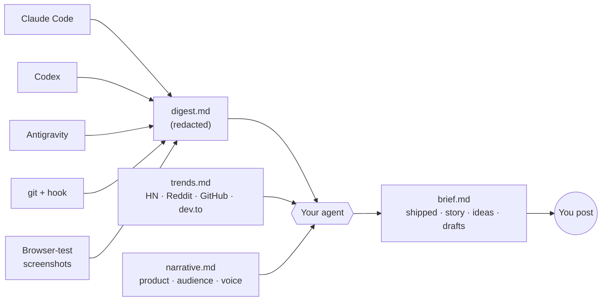

<div align="center">

# 🛠️ Build In Public

### Your personal build-in-public content strategist, living in your repo.

It watches the work you already do with your coding agents,<br>
connects it to what people are talking about this week,<br>
and hands you a nightly brief with ready-to-post drafts.

[](https://github.com/chetanya1998/build-in-public/actions/workflows/test.yml)
[](LICENSE)


[**Try the demo**](#-try-it-in-one-minute) · [Install](#-install) · [How it works](#-how-it-works) · [Privacy](#-privacy) · [Roadmap](#-roadmap)

</div>

---

> **You ship something real almost every day, then post nothing.**
> You forget what you did, or you can't see why anyone would care.

Build In Public reads the sessions **Claude Code, Codex and Antigravity** already save on your machine, plus your git history and the screenshots your agents took while testing. It finds the story in your day, links it to this week's conversations, and writes the posts. Every night at 12:00 am, or whenever you ask.

**It never posts for you.** You review, edit and post.

## ✨ What you get each morning

A `brief.md` like this one, from the [sample brief](skills/build-in-public/demo/sample-brief.md):

> **Today in one line**
> Fixed the bug that made invoices look wrong about money: due dates that moved a day depending on where you live.
>
> **Post idea #1 · X thread** · *"Our tests passed because CI lives in UTC"*
> A specific, painful bug every developer recognises, with a one-line root cause and a lesson they can apply today.
>
> **Draft**
> Our invoices showed the wrong due date to every customer west of London, and every test passed. …

Each brief has six parts:

| | Section | What's in it |
|---|---|---|
| 📌 | **Today in one line** | The headline of your day |
| 🚢 | **What you shipped** | 3 to 6 bullets, each linked to its session, commit or log entry |
| 📖 | **The story** | The struggle, the result, and where it moves your product |
| 🔥 | **What people are talking about** | This week's discussions that really connect to your work |
| 💡 | **Post ideas** | Ranked, each with a hook, platform, trend and screenshot to attach |
| ✍️ | **Ready-to-post drafts** | 1 or 2 full drafts in your voice, saved to `posts/` |

## 🚀 Try it in one minute

No setup, no network calls, nothing outside a temp folder touched:

```sh
git clone https://github.com/chetanya1998/build-in-public.git
cd build-in-public
sh skills/build-in-public/scripts/nightly.sh --demo --show
```

It builds a fictional project with a git history and sample Claude Code, Codex and Antigravity sessions, runs the real collector on it, and shows you:

- **`digest.md`**: what the skill actually pulled out of those sessions. Watch it redact an email, a token and an off-limits client name.
- **`brief.md`**: a sample brief for that same day, written by hand to show the format. Your real brief is written by your own agent.

## 📦 Install

```sh
sh install.sh              # Claude Code, Codex and Antigravity, for your user
sh install.sh --project    # or just the current project
sh install.sh --only codex # or a single agent
```

| Agent | User install | Project install |
|---|---|---|
| Claude Code | `~/.claude/skills/` | `.claude/skills/` |
| Codex | `~/.agents/skills/` | `.agents/skills/` |
| Antigravity | `~/.gemini/config/skills/` | `.agents/skills/` |

**Requirements:** Python 3.9+ only. For app screenshots, add `pip install playwright && playwright install chromium`.

## 🏁 Quick start

1. Open your project in your agent and say **"set up build in public"**.
2. Build as usual.
3. At 12:00 am you get a notification that `.buildinpublic/daily/<date>/brief.md` is ready. Or ask for **"build in public brief"** any time.

## 🧭 What it does

| Mode | Say this | What happens |
|---|---|---|
| ⚙️ **Setup** | "set up build in public" | Asks 5 short questions (product, audience, problem, voice, off-limits) and picks trend topics. Adds a logging rule to `AGENTS.md`, `GEMINI.md` and `CLAUDE.md`, and can install a git hook and schedule the nightly brief. |
| 📝 **Capture** | "log this", or automatically after a task | Adds a short entry to today's log (what, why, how, struggle, result) and tags story-worthy moments like `#war-story`, `#metric` and `#milestone`. |
| 🌙 **Daily brief** | runs at 12:00 am, or "build in public brief" | Reads the day's sessions, commits and screenshots, scans trends, and writes `brief.md`. |
| ✍️ **Create** | "what should I post?", "weekly recap", "write a thread" | Drafts for X, Threads, LinkedIn, Reddit, dev.to or a short video, in your voice, and keeps your story consistent over time. |

## ⚡ How it works



<details>
<summary><b>Where the data comes from</b></summary>

<br>

| Source | Read from | Notes |
|---|---|---|
| Claude Code | `~/.claude/projects/<repo-path>/*.jsonl` | prompts, agent replies, edited files, commands |
| Codex | `~/.codex/sessions/YYYY/MM/DD/*.jsonl[.zst]` | only sessions whose `cwd` is this repo; `.zst` needs `zstd` |
| Antigravity | `~/.gemini/antigravity*/brain/*/` | task, plan and walkthrough artifacts, browser screenshots and recordings |
| git | `git log`, `git diff --stat` | plus `commits.log` from the optional hook |
| Screenshots | `.playwright-mcp/`, `test-results/`, `playwright-report/`, `screenshots/` | plus `snapshot_urls` captured with Playwright |
| Trends | Hacker News, Reddit, GitHub, dev.to (no API keys) | your agent adds its own web search for X, LinkedIn and news |

Agent session formats change between releases, so the parser is deliberately tolerant. If a source shows 0 sessions, run `doctor.py` or `collect.py --inspect` and open an issue.

</details>

<details>
<summary><b>What gets created in your project</b></summary>

<br>

```
.buildinpublic/
├── narrative.md        product, audience, voice, off-limits, story so far
├── config.json         topics, platforms, brief time, agent, snapshot URLs
├── log/                entries your agents write during the day
├── commits.log         from the optional git hook
├── daily/2026-10-22/
│   ├── digest.md       sessions + git + log, redacted
│   ├── trends.md       this week's discussions per topic
│   ├── snapshots/      app and browser-test screenshots
│   ├── brief.md        your daily brief
│   └── nightly.log
├── posts/              drafts, never auto-published
└── assets/             screenshots and clips you saved
```

</details>

<details>
<summary><b>Run the pipeline by hand</b></summary>

<br>

```sh
SKILL=~/.claude/skills/build-in-public
python3 $SKILL/scripts/collect.py --inspect   # which sessions were found for this repo?
sh $SKILL/scripts/nightly.sh                  # full pipeline for today
sh $SKILL/scripts/schedule.sh --time 23:30    # change the schedule (--remove to stop)
python3 $SKILL/scripts/doctor.py              # check the setup
```

</details>

## 🩺 Troubleshooting

Something not working? Run this from your project:

```sh
python3 ~/.claude/skills/build-in-public/scripts/doctor.py
```

It checks your tools (Python, git, zstd, Playwright, your agent's CLI), the `.buildinpublic/` setup, the logging rules, the git hook, the nightly schedule, which sessions it can find for the last 7 days, and errors from the last nightly run. It's read-only and makes no network calls. Paste its output into an [issue](https://github.com/chetanya1998/build-in-public/issues) if you're stuck.

## 🔒 Privacy

| | |
|---|---|
| 🏠 **Runs locally** | Session files are read on your machine and never uploaded by these scripts. The only network calls are the public trend searches, which send your topic keywords. |
| 🧹 **Secrets redacted** | API keys, tokens, JWTs, private keys and emails are removed before anything is written, plus every term you list under **Off-limits** in `narrative.md`. |
| 📁 **This repo only** | Sessions from other projects are skipped. |
| 🙈 **Gitignored by default** | Setup asks whether you want to commit any of it. |
| 🤖 **Your agent, your model** | When your agent writes the brief, the redacted digest goes to that agent's model, like any other prompt. |
| 🚫 **No recording** | No screen capture, no keystroke logging. |

## 🚧 Roadmap

- [x] **Phase 1: Easy to try.** Demo mode, `doctor.py`, tests on sample sessions, CI.
- [ ] **Phase 2: Learns what works.** Log what you posted and how it did, so ideas are ranked by what gets a response from *your* audience. Voice training from your best past posts.
- [ ] **Phase 3: Better posts.** Before/after image pairs, metric cards, GIFs from browser-test recordings, automatic weekly recaps.
- [ ] **Phase 4: More reach.** Cursor, Windsurf, Gemini CLI and Aider. Export to Typefully or Buffer (you still approve every post). Team mode.

## 🤝 Contributing

PRs are welcome, especially new agents (Cursor, Windsurf, Gemini CLI), new trend sources and better prompts. Tests use only the standard library:

```sh
python3 -m unittest discover tests
```

See [CONTRIBUTING.md](CONTRIBUTING.md) for how to add a session source.

## 📄 License

[MIT](LICENSE) © Chetanya
