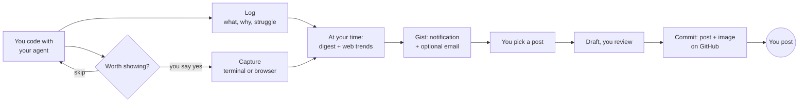
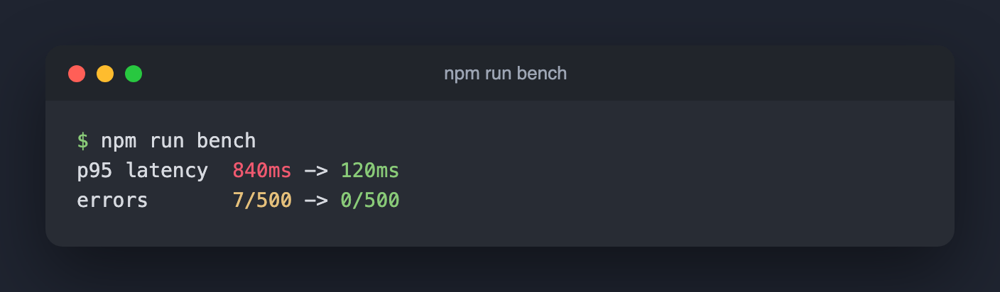

<div align="center">

# 🛠️ Build In Public

### Your personal build-in-public content strategist, living in your repo.

It logs what you build with your coding agents, captures the moments you approve,<br>
finds the trends nearest to your project and today's work,<br>
and sends you a daily gist with posts to choose from.<br>
Approved posts and images can go out with your commits, so they're on GitHub.

[](https://github.com/chetanya1998/build-in-public/actions/workflows/test.yml)
[](LICENSE)


[Install](#-install) · [How your day works](#-how-your-day-works) · [Captures](#-captures-only-with-your-ok) · [Daily gist](#-the-daily-gist) · [Posts on GitHub](#-your-posts-on-github) · [Privacy](#-privacy)

</div>

---

> **You ship something real almost every day, then post nothing.**
> You forget what you did, or you can't see why anyone would care.

Build In Public lives in your project. While you code with **Claude Code, Codex or Antigravity**, it keeps a log of what you built and why. When something is worth showing, it asks before capturing your terminal or browser. At the time you choose, it searches the internet for the conversations closest to your project and that day's work, and sends you a gist with a list of suggested posts. You pick one, it writes the post with a real anecdote from your day, and you review it and post it yourself.

**It never posts for you.**

## 🌅 How your day works



| When | What happens |
|---|---|
| **While you code** | After each meaningful task, your agent adds a short entry to today's log: what, why, how, the struggle and the result, with the exact anecdote (the error, the wrong guess, the fix). |
| **When something's worth showing** | Tests going green after a fight, a benchmark, a new screen in a Playwright test: your agent asks *"Capture this for today's story? 1) terminal output 2) browser screenshot 3) skip"*. Nothing is captured without a yes. |
| **At the time you chose** | It reads the day's agent sessions, git history, log and approved captures, searches the web for the trends nearest to your project and today's work, and writes the brief. |
| **Then** | You get a desktop notification with the gist, and an email too if you gave an address: the day in one line, what you shipped, and **5 to 7 suggested posts**. |
| **When you're ready** | Say *"review my posts"* or *"write post 2"*. Your agent drafts it for your platform, and you revise and approve it. |
| **When you commit** | If sharing is on, your approved posts and their images go into the commit. Push, then open them on GitHub from any device, copy, and post. |

## 📸 Captures, only with your OK

<div align="center">

</div>

| Capture | What's saved |
|---|---|
| **Terminal** | The command's output, redacted, as text for the story and as a terminal-window image like the one above for the post. It can run the command or use output you already have. |
| **Browser** | A screenshot of a page in your running app, on desktop and optionally mobile, with your local Playwright. |
| **Agent screenshots** | Screenshots your agents took during browser tests (Playwright MCP, test reports, Antigravity) are only *candidates*. You approve or reject each one. |

Posts only ever use approved captures. Turn capturing off with `"capture": "off"` in `.buildinpublic/config.json`.

## 📬 The daily gist

At the time you set (`brief_time`, for example 19:00), you get:

- **A desktop notification** with the day's headline.
- **An email (optional)** with the day in one line, what you shipped and the numbered list of suggested posts, with the full brief attached. **All it needs is your address:** no password, no mail server. On macOS it's sent through Apple Mail from the account you already use there. On Linux it goes through your system's `sendmail`.

Each suggested post has a title, platform, angle and hook line, the anecdote it uses, the trend it rides (with a link, or "no trend" when nothing truly fits), the capture to attach, and why it should work.

**The trends come from your project and your day.** Searches are built from three places: today's log entries and commits, the topics you gave during setup, and your stack (read from `package.json`, `requirements.txt`, `pyproject.toml`, `go.mod`, `Cargo.toml` or `Gemfile`). The script checks Hacker News, Reddit, GitHub and dev.to. Then your agent searches the web for what people are discussing on X, LinkedIn and in the news this week. A strong story with no trend beats a forced tie-in.

## 🐙 Your posts on GitHub

Turn on sharing during setup (or run `init.sh --share`), and every commit you make also carries the posts you **approved**, with the images they attach:

```
.buildinpublic/posts/
├── README.md                          ← one page: each post's text and image, newest first
├── 2026-10-22-x-ci-lives-in-utc.md
└── images/3ca93f-terminal-npm-run-bench.png
```

Push as usual, then open `.buildinpublic/posts/README.md` on GitHub, on your laptop or your phone, and copy the post with its image. Suggested posts you haven't approved are never added. If you've set up the email, the gist links to this page.

> **Public repo?** Then anyone can read the shared posts and see their images. Setup checks with you first, and `BIP_SKIP_SHARE=1 git commit …` skips sharing for a single commit.

## 📦 Install

```sh
git clone https://github.com/chetanya1998/build-in-public.git
cd build-in-public
sh install.sh              # Claude Code, Codex and Antigravity, for your user
sh install.sh --project    # or just the current project
sh install.sh --only codex # or a single agent
```

| Agent | User install | Project install |
|---|---|---|
| Claude Code | `~/.claude/skills/` | `.claude/skills/` |
| Codex | `~/.agents/skills/` | `.agents/skills/` |
| Antigravity | `~/.gemini/config/skills/` | `.agents/skills/` |

**Requirements:** Python 3.9+. For capture images: `pip install playwright && playwright install chromium`.

## 🏁 Set up your project

Open your project in your agent and say **"set up build in public"**. It asks a few short questions:

1. What you're building, who it's for, your voice, and what's off-limits.
2. **When you want the daily gist.**
3. **Your email address, if you want the gist emailed.** That's optional, and nothing else is needed: no password.
4. **Whether to add approved posts to your commits,** so you can open them on GitHub.
5. Your app's local URL, for browser captures.

Then it adds the logging and capture rule to `AGENTS.md`, `CLAUDE.md` and `GEMINI.md`, and schedules the gist. Build as usual from there.

## 💬 Things to say to your agent

| Say | What happens |
|---|---|
| "set up build in public" | One-time setup in this project |
| "log this" | Adds today's log entry now (your agent also does this after tasks) |
| "capture this" | Offers a terminal or browser capture, and asks first |
| "build in public brief" | Writes today's brief and the list of suggested posts now |
| "review my posts" | Shows the suggested posts so you can pick one |
| "write post 2 for LinkedIn" | Drafts it; you revise and approve it |
| "I posted it" | Marks it posted, with the link, and adds it to your story so far |
| "weekly recap" | Offers recap angles from the week's briefs |

<details>
<summary><b>Run the scripts by hand</b></summary>

<br>

```sh
SKILL=~/.claude/skills/build-in-public
python3 $SKILL/scripts/capture.py terminal --cmd "npm test"   # asks y/N, then captures
python3 $SKILL/scripts/capture.py browser --url http://localhost:3000 --mobile
python3 $SKILL/scripts/capture.py candidates                  # agent screenshots awaiting a yes or no
python3 $SKILL/scripts/capture.py approve <id>                # or: reject <id>
python3 $SKILL/scripts/collect.py --inspect                   # which sessions were found for this repo?
sh $SKILL/scripts/nightly.sh                                  # the full daily run, now
python3 $SKILL/scripts/notify.py --test                       # send a test email (if you set one)
python3 $SKILL/scripts/share.py                               # rebuild posts/README.md now
sh $SKILL/scripts/schedule.sh --time 19:00                    # change the gist time (--remove to stop)
python3 $SKILL/scripts/doctor.py                              # check the setup
```

</details>

<details>
<summary><b>Where the data comes from</b></summary>

<br>

| Source | Read from | Notes |
|---|---|---|
| Claude Code | `~/.claude/projects/<repo-path>/*.jsonl` | prompts, agent replies, edited files, commands |
| Codex | `~/.codex/sessions/YYYY/MM/DD/*.jsonl[.zst]` | only sessions whose `cwd` is this repo; `.zst` needs `zstd` |
| Antigravity | `~/.gemini/antigravity*/brain/*/` | task, plan and walkthrough artifacts; its screenshots become candidates |
| git | `git log`, `git diff --stat` | plus `commits.log` from the optional hook |
| Captures | `.buildinpublic/daily/<date>/captures/` | only what you approved |
| Trends | Hacker News, Reddit, GitHub, dev.to (no API keys) + your agent's web search | built from today's work, your topics and your stack |

Agent session formats change between releases, so the parser is deliberately tolerant. If a source shows 0 sessions, run `doctor.py` or `collect.py --inspect` and open an issue.

</details>

<details>
<summary><b>What gets created in your project</b></summary>

<br>

```
.buildinpublic/
├── narrative.md        product, audience, voice, off-limits, story so far
├── config.json         topics, platforms, gist time, agent, app URL, capture, notify, email
├── log/                entries your agents write during the day
├── commits.log         from the optional git hook
├── daily/2026-10-22/
│   ├── digest.md       sessions + git + log + captures, redacted
│   ├── trends.md       discussions near today's work, your project and your stack
│   ├── captures/       approved terminal and browser captures + captures.json
│   ├── brief.md        the gist and the suggested posts
│   └── nightly.log
├── posts/              drafts you chose: suggested → approved → posted
│   ├── README.md       approved posts with images, for GitHub
│   └── images/
└── assets/             anything else you saved for posts
```

Your email address lives outside the repo, in `~/.config/buildinpublic/email.json` (`{"to": "you@example.com"}`), and is shared by all your projects.

</details>

## 🩺 Troubleshooting

```sh
python3 ~/.claude/skills/build-in-public/scripts/doctor.py
```

It checks your tools (Python, git, zstd, Playwright, your agent's CLI), the `.buildinpublic/` setup, the logging rules, the git hook, gist delivery (notification and how the email would be sent), sharing posts with commits, the schedule, which sessions it can find for the last 7 days, and errors from the last run. It's read-only and makes no network calls. Paste its output into an [issue](https://github.com/chetanya1998/build-in-public/issues) if you're stuck.

## 🔒 Privacy

| | |
|---|---|
| 🏠 **Runs locally** | Session files are read on your machine and never uploaded by these scripts. Network calls: the trend searches (keywords only) and the optional gist email, sent to you from your own mail app. |
| ✋ **Captures need a yes** | Nothing from your terminal or browser is saved without your approval, and agent screenshots stay candidates until you approve them. |
| 🧹 **Secrets redacted** | API keys, tokens, JWTs, private keys and emails are removed from digests and captures, plus every term you list under **Off-limits**. |
| 🔑 **No passwords** | Email needs only your address. It's sent through the mail app you're already signed in to. |
| 🐙 **You choose what's shared** | Only posts you approved go into commits, and only if you turned sharing on. |
| 📁 **This repo only** | Sessions from other projects are skipped. |
| 🤖 **Your agent, your model** | When your agent writes the brief, the redacted digest goes to that agent's model, like any other prompt. |
| 🚫 **Never posts** | It drafts. You post. |

## 🚧 Roadmap

- [x] **Easy to trust.** `doctor.py`, tests on sample sessions for every agent, CI on macOS and Linux.
- [x] **Your day, your approval.** Captures only with your OK, trends from your stack and today's work, the scheduled gist by notification and optional email, choosing what to post, and approved posts on GitHub with your commits.
- [ ] **Learns what works.** Log how each post did, so suggestions are ranked by what gets a response from *your* audience. Voice training from your best past posts.
- [ ] **Better visuals.** Before/after pairs, metric cards, GIFs from browser-test recordings.
- [ ] **More reach.** Cursor, Windsurf, Gemini CLI and Aider. Export to Typefully or Buffer (you still approve every post).

## 🤝 Contributing

PRs are welcome, especially new agents (Cursor, Windsurf, Gemini CLI), new trend sources and better prompts. Tests use only the standard library:

```sh
python3 -m unittest discover tests
```

See [CONTRIBUTING.md](CONTRIBUTING.md) for how to add a session source.

## 📄 License

[MIT](LICENSE) © Chetanya
